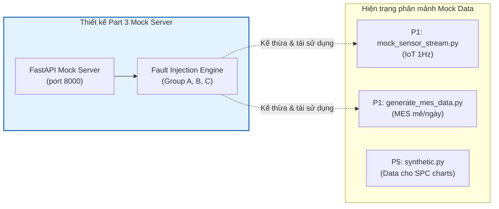

> Historical planning material (2026-11-17): this file is not the status source for the implemented storage demo. Use [tasks/plan.md](../tasks/plan.md) and [tasks/todo.md](../tasks/todo.md).

# RÀ SOÁT VÀ PHÂN TÍCH TRÙNG LẶP CHỨC NĂNG (DOCS/PLAN.MD VS BRANCH HIỆN TẠI)

## Goal Description

Kế hoạch `docs/plan.md` (Version 2.0) đề xuất hoàn thiện toàn diện hệ thống **Lakehouse Storage** qua 4 giai đoạn:
- **Part 1:** Storage Core (Bronze Integrity, Ingestion Ledger, Silver Strict Enforcement, Checksum, Guard Rails Engine, Remediation Management).
- **Part 2:** Automatic Maintenance (Policy, Small File Detection, Auto-Compaction, Z-Order, Safe Vacuum, Maintenance Scheduler, Maintenance Guard Rails).
- **Part 3:** Storage Testing Mock Server (FastAPI Server, Schema-driven Generator, Fault Injection Scenarios, Endpoints, Replay).
- **Part 4:** End-to-End Integration & Validation (Storage Integration, MinIO E2E, Failure/Recovery, Observability).

Báo cáo này tiến hành rà soát đối chiếu toàn bộ các chức năng trên với hiện trạng mã nguồn trên branch `feature/storage-core-v1` (bao gồm cả các module của các nhóm P1 `lakehouse_storage`, P2 `crawling_ingestion`, P3 `data_governance`, P4 `olap_engineering`, và P5 `manufacturing_spc`) nhằm:
1. Phát hiện các chức năng **đã được cài đặt** trên branch.
2. Phát hiện các điểm **trùng lặp chức năng (functional overlaps)** hoặc **xung đột ranh giới kiến trúc (boundary conflicts)** giữa Storage (P1) và các module khác (P2, P3, P4, P5).
3. Đề xuất ma trận ranh giới kiến trúc rõ ràng và kế hoạch triển khai cho Part 2, 3, 4 để không chồng chéo hoặc phá vỡ các module liên quan.

---

## User Review Required

> [!IMPORTANT]
> **Part 1 đã được triển khai hoàn tất trên branch hiện tại (commit `c23d32f`):**
> Toàn bộ các chức năng từ mục 1.1 đến 1.8 (`bronze_publisher.py`, `ingestion_ledger.py`, `checksum.py`, `guardrails/`, `quarantine.py`, `remediation.py`, `retention.py`, `silver_manager.py`) đã có trong `src/lakehouse_storage/` và đạt 100% test pass (267 storage tests + 7 downstream compat tests). Vì vậy, **không cần viết lại Part 1**, chỉ cần tiếp tục triển khai Part 2, Part 3, Part 4.

> [!WARNING]
> **Điểm chồng lấn lớn nhất: P1 `lakehouse_storage.guardrails` vs P3 `data_governance` (Gatekeeper, GX, Outliers):**
> Cả hai module hiện tại đều có bộ kiểm tra hợp lệ dữ liệu (validation), kiểm tra ngưỡng vi phạm 0.5% (gate threshold 0.005), xử lý dòng/lô cách ly (quarantine), và ghi nhận bằng chứng (evidence/ledger). Nếu không phân định rõ ranh giới, hệ thống sẽ bị trùng lặp kiểm tra 2 lần và sinh ra 2 kho quarantine khác nhau (`data/_quarantine` và `data/quality_quarantine`).

> [!CAUTION]
> **Nguy cơ trùng lặp bộ sinh dữ liệu giả lập (Mock Data Generators):**
> Dự án đang có 3 bộ sinh dữ liệu riêng lẻ:
> 1. `src/lakehouse_storage/mock_sensor_stream.py` (P1 - sinh sensor 1Hz).
> 2. `src/lakehouse_storage/generate_mes_data.py` (P1 - sinh MES mẻ/ngày).
> 3. `src/manufacturing_spc/synthetic.py` (P5 - sinh sensor và batch cho kiểm thử SPC).
> Nếu Part 3 (Mock Server) viết thêm một bộ sinh dữ liệu độc lập thứ 4 trong FastAPI, dữ liệu sẽ phân mảnh và không đồng bộ schema contract v1.

---

## Ma trận đối chiếu tổng thể (Cross-Module Overlap Matrix)

| Chức năng trong `docs/plan.md` | Hiện trạng trên branch | Module liên quan khác | Mức độ trùng lặp | Đánh giá & Ranh giới kiến trúc khuyến nghị |
|---|---|---|---|---|
| **1.1 Contract & Schema Audit** | Đã xong (`contract.py`, `schemas.py`) | P3 `data_governance/contracts.py` | ⚠️ **Trùng lặp định nghĩa** | Cả P1 và P3 đều giữ schema contract. P1 `schemas.py` là Source of Truth cho PyArrow và MinIO Partition. P3 giữ Great Expectations specs. Cần đồng bộ qua `test_contracts.py`. |
| **1.2 Bronze Writer & Checksum** | Đã xong (`bronze_publisher.py`, `checksum.py`) | P2 `crawling_ingestion`, P3 `bronze_loader.py` | 🟢 **Không xung đột** | P2 gọi `write_bronze_batch` của P1; P3 đọc Bronze qua `bronze_loader.py`. Phân công đúng chuẩn. |
| **1.3 Idempotency & Ingestion Ledger** | Đã xong (`ingestion_ledger.py`, `ops_store.py`) | P3 `data_governance/silver_writer.already_ingested` | 🟡 **Trùng lặp mục đích** | P1 kiểm tra ledger ở cấp batch/file trước khi xử lý; P3 scan Delta table để tìm `_bronze_sha256`. P1 là state machine vận hành, P3 là idempotency ở đích Delta. Hoạt động bổ trợ tốt. |
| **1.4 Silver Strict Enforcement & Quarantine** | Đã xong (`silver_manager.py`, `quarantine.py`) | P3 `silver_writer.py`, `transformers.py`, `outliers.py` | 🔴 **Chồng lấn cao** | P3 có pipeline riêng (`run_governance.py`) tự transform, lọc lỗi và ghi Delta. P1 cũng có `ingest_batch`. **Giải pháp:** P1 giữ `append_to_delta` làm tầng ghi vật lý ACID; P3 là logic nghiệp vụ governance; P1 `ingest_batch` tích hợp `transform` hook của P3. |
| **1.7 Guard Rails Engine** | Đã xong (`guardrails/`) | P3 `gatekeeper.py`, `validator.py`, P5 `nelson_rules.py` | 🟡 **Chồng lấn phạm vi** | P1 Guard Rails bảo vệ tầng lưu trữ vật lý (chặn corrupt, malformed, size limit, batch consistency). P3 kiểm tra chất lượng dữ liệu nghiệp vụ (DAMA dimensions, Great Expectations). P5 kiểm soát thống kê tiến trình (SPC). |
| **1.8 Remediation Management** | Đã xong (`remediation.py`, `ops_cli.py`) | Chưa có module nào khác | 🟢 **Độc nhất (Unique P1)** | Không có module nào quản lý quy trình khắc phục lỗi lưu trữ (remediation tickets). |
| **2.1 - 2.5 Delta Maintenance (Compaction, Z-Order, Vacuum)** | Đã có hàm cơ sở (`maintenance.py`, `retention.py`), chưa có policy/tự động hóa | Không có module nào khác | 🟢 **Độc nhất (Unique P1)** | P2, P3, P4, P5 hoàn toàn không làm maintenance Delta Lake. Cần đóng gói thêm `MaintenancePolicyManager` và trigger logic dựa trên code có sẵn. |
| **2.6 Maintenance Scheduler** | Chưa triển khai | Không có module nào khác | 🟢 **Độc nhất (Unique P1)** | Cần scheduler chạy nền (Cron/Worker) điều phối compaction/vacuum. Cần khóa tương tranh (lock) với Ingestion Ledger để tránh xung đột ghi/đọc. |
| **2.7 Maintenance Guard Rails** | Một phần trong `retention.py` (`vacuum_safe`) | Chưa có | 🟢 **Độc nhất (Unique P1)** | Mở rộng Guard Rails để chặn lệnh vacuum vi phạm retention window 168h hoặc compaction khi đang có batch commit dở dang. |
| **3.1 - 3.2 Mock Server & Generator** | Chưa có FastAPI; đã có script sinh S1/S2 | P5 `synthetic.py`, P1 `mock_sensor_stream.py`, `generate_mes_data.py` | 🔴 **Nguy cơ trùng lặp Generator** | Part 3 **không được tạo bộ sinh số liệu mới từ đầu**. Phải tái sử dụng và kế thừa `mock_sensor_stream.py` và `generate_mes_data.py`, đóng gói API qua FastAPI. |
| **3.3 Fault Injection Framework** | Đã có kịch bản test trong `tests/` | P3 `outliers.py` (Hampel test) | 🟢 **Bổ trợ giá trị cao** | Part 3 đóng gói các ca lỗi (Contract violations, Out-of-range, Spikes, Corrupted files) thành các kịch bản API/CLI declarative để phục vụ kiểm thử hệ thống. |
| **3.4 - 3.5 FastAPI Endpoints & Replay** | Chưa triển khai | Không có module nào khác | 🟢 **Độc nhất (Unique P1)** | Toàn bộ repo chưa có REST API nào; đây là Mock Server phục vụ riêng cho kiểm thử storage. |
| **4.1 - 4.5 E2E Testing & MinIO** | Đã có `test_minio_e2e.py`, `test_ingestion_pipeline.py` | P3 `test_data_governance_local_e2e.py`, `chdb_silver_acceptance.py` | 🟡 **Trùng lặp phạm vi E2E** | P3 test luồng governance (GX -> Data Docs -> Marquez). P1 E2E test độ bền bỉ tầng lưu trữ (crash recovery, interrupted write, concurrency, vacuum safety). Cần phân biệt rõ test mục tiêu. |
| **4.6 Storage Observability** | Đã có `OpsStore`, `ops_cli.py` | P3 `reporting.py`, `lineage.py`, `gx_context.py` | 🟡 **Nguy cơ trùng lặp báo cáo** | P3 phụ trách Data Quality Reports, GX HTML Data Docs, và OpenLineage Marquez. Storage Observability **chỉ theo dõi Storage Engine metrics**: số lượng file, kích thước bảng, tỷ lệ file nhỏ, thời gian compaction, trạng thái ledger. |

---

## Chi tiết phân tích từng phần dự định thêm vào

### 1. Về Part 1 (Cải tiến Storage Core)

```mermaid
flowchart TD
    subgraph Part1_Status ["Hiện trạng Part 1 (Branch feature/storage-core-v1)"]
        A["1.1 Contract Audit"] --> B["1.2 Bronze Publisher & Checksum"]
        B --> C["1.3 Ingestion Ledger & OpsStore"]
        C --> D["1.4 Silver Manager & Strict Gate"]
        D --> E["1.5 Checksum 5 Statuses"]
        E --> F["1.6 Time Travel & Retention 168h"]
        F --> G["1.7 Guard Rails Engine"]
        G --> H["1.8 Remediation Lifecycle"]
        H --> I["1.9 Part 1 Checkpoint: 267 Storage Tests PASS"]
    end
    style Part1_Status fill:#e8f5e9,stroke:#2e7d32,stroke-width:2px
```



- **Kết luận:** Toàn bộ Part 1 **đã hoàn thành** trong commit `c23d32f`. Không cần thêm mới mã nguồn cho Part 1, tránh tạo file thừa hoặc ghi đè code đã được nghiệm thu trong checkpoint.
- **Vấn đề ranh giới với P3 (`data_governance`):**
  - Hiện tại P3 có `run_governance.py` chạy độc lập với `ingest_batch()` của P1. Cả hai đều kiểm tra schema và ghi Silver qua `append_to_delta`.
  - Hai kho quarantine đang tách rời: P1 lưu batch lỗi tại `data/_quarantine/`, P3 lưu các dòng lỗi tại `data/quality_quarantine/`.
  - **Khuyến nghị:** Giữ nguyên sự độc lập này theo nguyên tắc phân lớp: P1 bảo vệ Storage Core (hạ tầng lưu trữ); P3 thực thi quản trị chất lượng dữ liệu doanh nghiệp (business governance).

---

### 2. Về Part 2 (Automatic Maintenance)

- **Các chức năng dự định thêm:**
  - `MaintenancePolicy`: Cấu hình policy riêng cho từng bảng (ngưỡng file nhỏ, kích thước file mục tiêu, cột Z-order, giờ retention).
  - `SmallFileDetector`: Phân tích thống kê Delta log để tính tỷ lệ file nhỏ.
  - `MaintenanceScheduler`: Bộ lập lịch định kỳ (cron hoặc thread worker) tự động kích hoạt bảo trì.
  - `MaintenanceGuardRails`: Kiểm tra trạng thái an toàn trước khi chạy compaction/vacuum.
- **Rà soát trùng lặp:**
  - **Với các module ngoài:** Hoàn toàn **không trùng lặp** với bất kỳ module nào (P2, P3, P4, P5 không làm nhiệm vụ bảo trì Delta).
  - **Với code nội bộ P1:** `src/lakehouse_storage/maintenance.py` đã có các hàm thao tác Delta cấp thấp: `compact_table`, `zorder_table`, `vacuum_table`, `get_table_stats`, `get_optimization_recommendations`. Đồng thời `retention.py` đã có `vacuum_safe` và `preview_vacuum`.
- **Kế hoạch triển khai không trùng lặp:**
  - Không viết lại các hàm optimize Delta.
  - Tạo thêm module điều phối cấp cao:
    - `src/lakehouse_storage/maintenance_policy.py`: Định nghĩa dataclass `TableMaintenancePolicy` và registry cấu hình cho 6 bảng Delta.
    - `src/lakehouse_storage/maintenance_scheduler.py`: Runner kiểm tra điều kiện kích hoạt (`auto_compact_if_needed`, `vacuum_table`), kiểm tra concurrency lock với `IngestionLedger` trước khi chạy.
    - Tích hợp kết quả bảo trì vào `OpsStore` và CLI `ops_cli.py maintenance run`.

---

### 3. Về Part 3 (Storage Testing Mock Server)



- **Các chức năng dự định thêm:**
  - FastAPI application với các endpoints `/health`, `/generate`, `/scenarios`, `/scenarios/{name}/run`, `/ingest`, `/replay`.
  - Schema-driven data generator cho SCADA (S1) và MES (S2).
  - Fault Injection framework tạo dữ liệu vi phạm contract, bất thường cảm biến, lỗi vận hành.
- **Rà soát trùng lặp:**
  - **Trùng lặp bộ sinh dữ liệu:** Dự án đã có `mock_sensor_stream.py` và `generate_mes_data.py` trong `lakehouse_storage`, và `synthetic.py` trong `manufacturing_spc`. Nếu Part 3 code lại generator mới sẽ gây phân mảnh và sai khác về phân phối dữ liệu/schema contract v1.
  - **Phạm vi nguồn dữ liệu:** P2 phụ trách S3 (GDT, FAO, USDA), S4 (weather), S5 (food_recalls). Mock Server **chỉ được mô phỏng S1 và S2**, tuyệt đối không mô phỏng các nguồn cào web của P2.
  - **Tương tác ghi dữ liệu:** Theo Constraint 4 của kiến trúc, Mock Server **không được ghi trực tiếp vào Delta Lake**, mà phải gọi qua `ingest_batch()` hoặc REST endpoint của ingestion.
- **Kế hoạch triển khai không trùng lặp:**
  - Tạo package `src/lakehouse_storage/mock_server/`:
    - `generator.py`: Wrapper tái sử dụng trực tiếp các hàm `generate_sensor_batch()` và `generate_mes_batch()` từ code P1 sẵn có.
    - `fault_injector.py`: Nhận DataFrame chuẩn từ generator rồi áp dụng các phép biến đổi lỗi (drop column, corrupt dtype, inject null, inject out-of-range, corrupt checksum sidecar, duplicate batch_id).
    - `app.py`: FastAPI routes exposed ra ngoài để test tự động hoặc chạy qua Docker Compose.

---

### 4. Về Part 4 (End-to-End Integration & Observability)

- **Các chức năng dự định thêm:**
  - Tích hợp toàn trình: Mock Server -> Ingestion -> Guard Rails -> Silver -> Maintenance.
  - MinIO E2E tests, Crash recovery tests, Performance benchmark.
  - Storage Observability: Theo dõi số lượng file, thời gian nạp, tỷ lệ file nhỏ, vi phạm guard rails.
- **Rà soát trùng lặp:**
  - **Với P3 `data_governance`:** P3 đã có hệ thống báo cáo chất lượng dữ liệu chi tiết (`reporting.py`, `visualization.py`), Data Docs Great Expectations HTML (`gx_context.py`), và Lineage phát tán tới Marquez (`lineage.py`, `marquez_evidence.py`). Nếu Storage xây dựng dashboard hoặc báo cáo chất lượng dữ liệu tương tự sẽ bị trùng lặp công việc của P3.
  - **Với P4 `olap_engineering`:** P4 dùng chDB để benchmark và xây dựng Fact/Dim Marts. Storage không chạy truy vấn phân tích nghiệp vụ OLAP.
- **Kế hoạch triển khai không trùng lặp:**
  - **Storage Observability** thu hẹp đúng phạm vi kỹ thuật lưu trữ: chỉ xuất metrics về **Dung lượng file, số lượng file, tỷ lệ small files, thời gian commit Delta, số lần compaction, và trạng thái Ledger/Remediation trong `OpsStore`**. Không vẽ biểu đồ nghiệp vụ hay sinh Data Docs trùng với P3.
  - Tận dụng `OpsStore` SQLite đã xây dựng ở Part 1 để truy vấn metrics và hiển thị qua lệnh `ops_cli.py observability summary`.

---

## Proposed Changes (Kế hoạch hành động chi tiết)

### Component 1: Automatic Maintenance (Part 2)
Mở rộng chức năng bảo trì tự động và lập lịch, tận dụng `maintenance.py` và `retention.py` hiện có.

#### [NEW] `src/lakehouse_storage/maintenance_policy.py`
- Định nghĩa dataclass `TableMaintenancePolicy`:
  - `small_file_threshold`: Số file tối đa trước khi compact (mặc định 50).
  - `target_file_size_mb`: Kích thước file mong muốn sau compact (mặc định 128MB).
  - `zorder_columns`: Danh sách cột tối ưu Z-order theo workload query.
  - `retention_hours`: Thời gian lưu trữ tối thiểu trước khi vacuum (mặc định 168h).
  - `auto_vacuum_enabled`: Cờ cho phép vacuum tự động hay chỉ dry-run.
- Registry chính thức: `TABLE_MAINTENANCE_POLICIES` cho 6 bảng Silver.

#### [NEW] `src/lakehouse_storage/maintenance_scheduler.py`
- Lớp `MaintenanceScheduler`:
  - Kiểm tra trạng thái tương tranh với `IngestionLedger` (không chạy compaction/vacuum trên bảng đang có batch ở trạng thái `RECEIVED` hoặc `VALIDATING`).
  - Kiểm tra điều kiện kích hoạt (`SmallFileDetector`).
  - Thực thi các tác vụ: `compact_table`, `zorder_table`, `vacuum_table` (dry-run trước, chỉ vacuum khi đạt ngưỡng).
  - Ghi nhật ký thực thi vào `OpsStore`.

#### [MODIFY] `src/lakehouse_storage/ops_cli.py`
- Bổ sung sub-command `maintenance`:
  - `ops_cli.py maintenance run --table <table> [--dry-run]`
  - `ops_cli.py maintenance check --table <table>`
  - `ops_cli.py maintenance history`

---

### Component 2: Storage Testing Mock Server (Part 3)
Cung cấp mock server phục vụ kiểm thử lưu trữ độc lập, tái sử dụng generator sẵn có.

#### [NEW] `src/lakehouse_storage/mock_server/__init__.py`
#### [NEW] `src/lakehouse_storage/mock_server/generator.py`
- Gọi và đóng gói các hàm:
  - `lakehouse_storage.mock_sensor_stream.generate_sensor_batch`
  - `lakehouse_storage.generate_mes_data.generate_mes_batch`
  - Sinh payload chuẩn contract v1.

#### [NEW] `src/lakehouse_storage/mock_server/fault_injector.py`
- Lớp `FaultInjector` định nghĩa các scenario:
  - `MISSING_REQUIRED_FIELD`: Xóa cột bắt buộc.
  - `WRONG_DATA_TYPE`: Đổi số thành chuỗi không thể ép kiểu.
  - `OUT_OF_RANGE`: Đưa nhiệt độ UHT lên 200°C hoặc áp suất lên 500 bar.
  - `CHECKSUM_MISMATCH`: Sửa nội dung file sau khi đã tính SHA-256.
  - `DUPLICATE_BATCH`: Gửi lại cùng batch ID với payload cũ.
  - `CONFLICTING_PAYLOAD`: Gửi lại cùng batch ID với payload khác.

#### [NEW] `src/lakehouse_storage/mock_server/app.py`
- FastAPI web service:
  - `GET /health`
  - `GET /scenarios`
  - `POST /scenarios/{name}/run`
  - `POST /ingest` (chuyển tiếp gọi vào `lakehouse_storage.ingestion.ingest_batch`)
  - `GET /batches/{batch_id}`

#### [NEW] `infra/Dockerfile.mock_server` & cập nhật `infra/docker-compose.mock.yml`
- Container hóa Mock Server để chạy trong môi trường tích hợp MinIO.

---

### Component 3: Integration & Observability (Part 4)
Kiểm thử toàn trình và báo cáo trạng thái vận hành lưu trữ.

#### [NEW] `tests/test_maintenance_scheduler.py`
- Kiểm thử chính sách policy, phát hiện file nhỏ, lập lịch, ngăn chặn tương tranh với ingestion, và ghi nhật ký execution history.

#### [NEW] `tests/test_mock_server_api.py`
- Kiểm thử các endpoints của Mock Server qua `TestClient`, kiểm tra kết quả tiêm lỗi tương ứng với phản ứng của Guard Rails.

#### [MODIFY] `src/lakehouse_storage/ops_store.py` & `ops_cli.py`
- Bổ sung chức năng xuất báo cáo Storage Observability tổng hợp (file stats, ledger state summary, guardrails violation metrics) dưới dạng JSON hoặc bảng text.

---

## Verification Plan

### Automated Tests
1. **Kiểm tra tương thích ngược và bộ test hiện tại:**
   ```bash
   PYTHONPATH=src ./.venv/bin/pytest tests/test_contracts.py tests/test_downstream_compat.py -v
   PYTHONPATH=src ./.venv/bin/pytest tests/test_bronze_*.py tests/test_silver_*.py tests/test_guardrails.py -q
   ```
2. **Kiểm thử module Maintenance mới:**
   ```bash
   PYTHONPATH=src ./.venv/bin/pytest tests/test_maintenance.py tests/test_retention.py tests/test_maintenance_scheduler.py -v
   ```
3. **Kiểm thử Mock Server & Fault Injection:**
   ```bash
   PYTHONPATH=src ./.venv/bin/pytest tests/test_mock_server_api.py -v
   ```
4. **Kiểm thử MinIO E2E:**
   ```bash
   docker compose -f infra/docker-compose.minio.yml up -d
   PYTHONPATH=src ./.venv/bin/pytest tests/test_minio_e2e.py -v -m minio
   ```

### Manual Verification
1. Chạy thử CLI ops maintenance:
   ```bash
   PYTHONPATH=src python -m lakehouse_storage.ops_cli maintenance check --table sensor_telemetry
   ```
2. Khởi động Mock Server cục bộ và gọi endpoint health check / run scenario:
   ```bash
   PYTHONPATH=src uvicorn lakehouse_storage.mock_server.app:app --port 8000
   curl -X POST http://localhost:8000/scenarios/out_of_range/run
   ```
3. Kiểm tra tính toàn vẹn của bảng Silver và đảm bảo batch lỗi bị chặn vào quarantine thay vì ghi trực tiếp vào Delta Lake.
