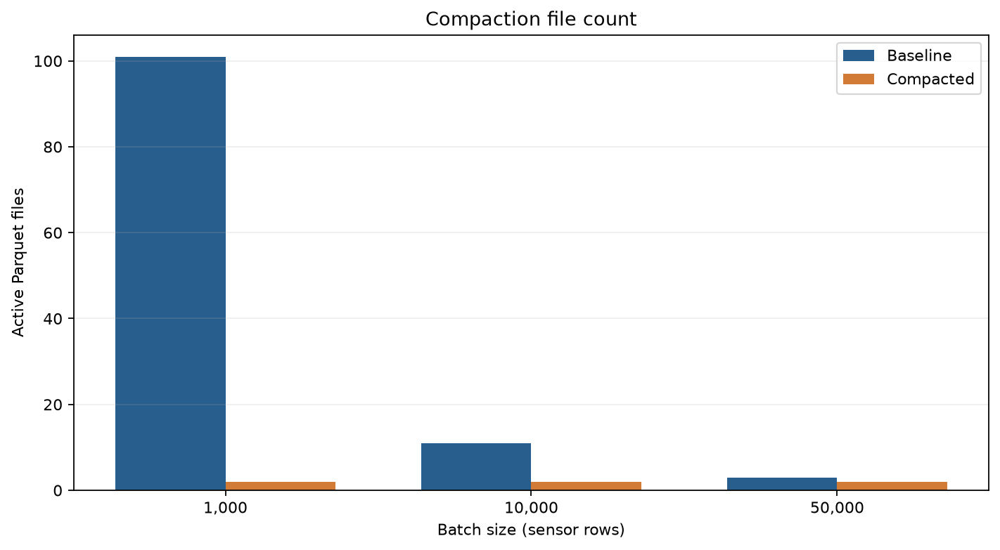
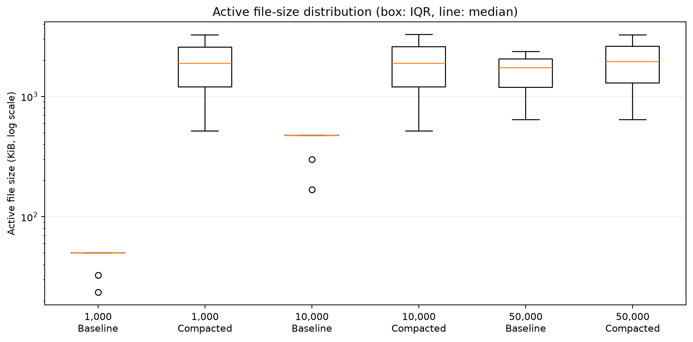
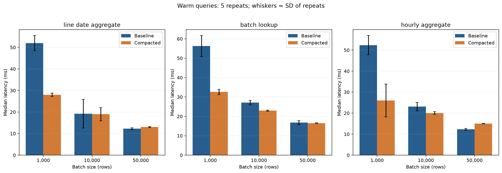
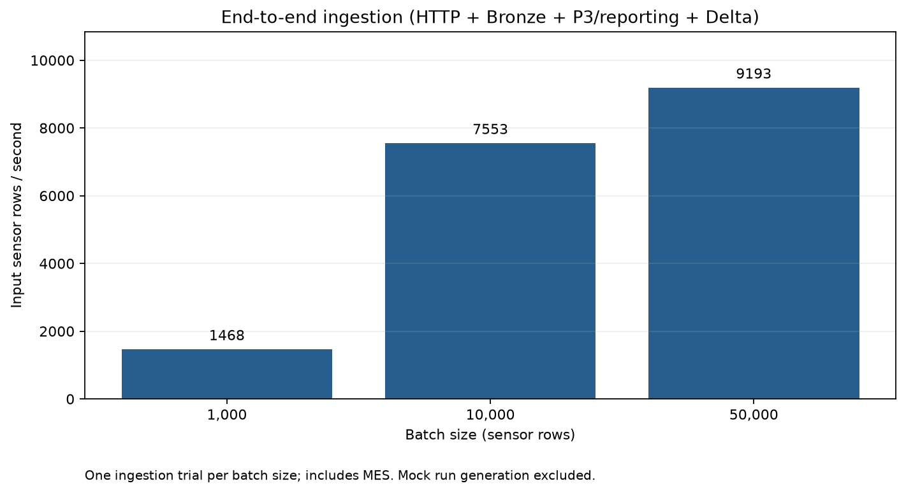

# Measured storage benchmark

Rows: 100,000; seed: 42; query repeats: 5.

Source: [metrics.json](metrics.json), [queries.csv](queries.csv), [operations.jsonl](operations.jsonl).

| Batch size | Accepted / rejected | Files before / after | End-to-end rows/s | Compaction (s) |
|---|---|---|---|---|
| 1,000 | 100,000 / 0 | 101 / 2 | 1467.8 | 0.345 |
| 10,000 | 100,000 / 0 | 11 / 2 | 7553.1 | 0.247 |
| 50,000 | 100,000 / 0 | 3 / 2 | 9193.0 | 0.331 |

S3 retained physical bytes are unknown; active-byte changes do not mean disk was freed.
Warm cache is uncontrolled. Throughput is a single end-to-end trial; P3 time includes reports.
Synthetic one-line workload; no conclusion about business causality or multi-partition pruning.

