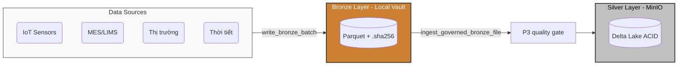

# 🥛 Lakehouse Storage Module

> **Smart Dairy Factory Lakehouse Core Engine**  
> Quản lý toàn bộ vòng đời lưu trữ dữ liệu nhà máy sữa UHT theo kiến trúc Medallion (Bronze ➔ Silver) trên nền **MinIO (S3)** và **Delta Lake**.

---

## 🏗️ Kiến trúc luồng dữ liệu (Data Flow)



---

## ⚡ Quick Start (Copy & Paste)

Luồng chính cho dữ liệu dùng với Gold là generator → Bronze → P3 → Silver.
Cài dependencies P3 theo `requirements.txt` và bộ pin dịch vụ nếu cần. Chọn roots
riêng; local Delta trong môi trường này nên dùng đường dẫn tuyệt đối không có dấu cách.

```bash
PYTHONPATH=src .venv/bin/python -m lakehouse_storage.mock_sensor_stream \
  --batches 1 --samples 20 --seed 42 \
  --bronze-root /tmp/storage_generator/bronze \
  --silver-root /tmp/storage_generator/silver \
  --reports-root /tmp/storage_generator/reports

PYTHONPATH=src .venv/bin/python -m lakehouse_storage.generate_mes_data \
  --days 1 --date 2026-01-15 --seed 5425 --defect-rate 0 --write-delta \
  --bronze-root /tmp/storage_production/bronze \
  --silver-root /tmp/storage_production/silver \
  --reports-root /tmp/storage_production/reports
```

`--silver-root` hoặc `STORAGE_GENERATOR_SILVER_ROOT` bắt buộc khi CLI ghi Delta.
`STORAGE_GENERATOR_BRONZE_ROOT` và `STORAGE_GENERATOR_REPORTS_ROOT` cung cấp default
cho hai roots còn lại. CLI in toàn bộ kết quả P3; FAIL/infrastructure error trả
exit code 1. Gate giữ threshold 0.005; dữ liệu mock có thể bị từ chối. CLI MES
không có `--write-delta` vẫn xuất raw như trước.

Entry point tương ứng cho một file Bronze đã có:

```python
from lakehouse_storage import ingest_governed_bronze_file, trace_batch
from olap_engineering.build_marts import scan_silver

result = ingest_governed_bronze_file(
    bronze_path, "sensor_telemetry",
    bronze_root="/tmp/storage_generator/bronze",
    silver_root="/tmp/storage_generator/silver",
    reports_root="/tmp/storage_generator/reports",
)
if result["status"] not in {"PASS", "PASS_WITH_REJECTIONS", "SKIPPED_DUPLICATE"}:
    raise RuntimeError(result)
accepted = scan_silver("sensor_telemetry", "/tmp/storage_generator/silver").collect()
```

Replay cùng file dùng gate chống trùng hiện có của P3. Đây là đường ghi tuần tự;
không đảm bảo exactly-once giữa nhiều process. Bảng legacy thiếu governance bị
báo lỗi, không tự migrate hoặc tự gắn PASS. Adapter demo vẫn giới hạn namespace.

Các helper `write_sensor_batch`, `write_mes_batch`, `_write_sensor_to_delta`,
`ingest_bronze_file` và `append_to_delta` là API storage low-level tương thích:
chúng có thể ghi lineage nhưng không chạy quality gate. Dữ liệu từ những helper
này chưa đảm bảo điều kiện Gold. Demo storage thuần chỉ nên dùng target riêng.

---

## 🛠️ Tùy chọn cấu hình môi trường

Tất cả cấu hình được quản lý qua biến môi trường (hoặc file `.env` ở thư mục gốc).

> [!IMPORTANT]  
> Yêu cầu phải khởi động MinIO container trước khi thực hiện thao tác với tầng Silver:  
> `docker compose -f infra/docker-compose.minio.yml up -d`

```bash
# S3 Configuration
MINIO_ENDPOINT=localhost:9000
MINIO_ACCESS_KEY=dairy
MINIO_SECRET_KEY=hustit5425
MINIO_BUCKET=smart-dairy-lakehouse

# Local Bronze Directory
BRONZE_PATH=data/01_bronze_vault
```

---

## 📂 Danh mục bảng dữ liệu (Tables Registry)

| ID | Bảng (`table_name`) | Phân vùng vật lý (`partition_by`) | Nguồn / Ý nghĩa |
| :-- | :--- | :--- | :--- |
| **S1** | `sensor_telemetry` | `line_id`, `ingestion_date` | IoT Telemetry cảm biến nhiệt, áp suất |
| **S2** | `mes_lims` | `line_id`, `ingestion_date` | Nhật ký mẻ sản xuất & kiểm nghiệm vi sinh |
| **S3** | `market_prices` | `ingestion_date` | Giá nguyên liệu thế giới (GDT, CME, USDA) |
| **S3b**| `market_indices` | `ingestion_date` | Chỉ số giá sữa FAO (Dữ liệu vĩ mô) |
| **S4** | `weather` | `farm_id`, `ingestion_date` | Thời tiết trang trại & chỉ số THI stress |
| **S5** | `food_recalls` | `ingestion_date` | Cảnh báo thu hồi an toàn thực phẩm FDA/VFA |
| **Meta**| `bronze_metadata` | `fetched_at` | Metadata quy trình cào dữ liệu tự động |

---

## 🧩 Tổng quan Modules

- **`schemas`**: Chứa PyArrow Schemas trung tâm (Source of Truth).
- **`bronze_writer`**: Xử lý ghi dữ liệu raw xuống ổ cứng cục bộ an toàn, chống ghi đè.
- **`silver_manager`**: Quản lý thao tác đọc/ghi ACID với Delta Lake MinIO.
- **`time_travel`**: Cung cấp hàm tra cứu quá khứ & hỗ trợ kiểm toán chất lượng.
- **`maintenance`**: Công cụ dọn rác, chống phân mảnh (`compact`, `z-order`, `vacuum`).

> [!TIP]  
> Mọi hàm public, cấu trúc tham số, và các ngoại lệ (Exception) đều được tài liệu hóa chi tiết tại:  
> 👉 **[API_REFERENCE.md](file:///home/kh0ngm1nh/Documents/HUST/20261/Data%20management%20and%20visualization%20-%20IT5425/Project/ProjectIT5425_Nhom2/src/lakehouse_storage/API_REFERENCE.md)**

## Isolated storage services and benchmark (2026-11-17)

The optional demo adds persisted S1/S2 mock HTTP, one checkpointed worker through
P3, a UTC maintenance scheduler, and measured layout benchmarks with four charts.
Start with [the walkthrough](../../docs/storage_demo.md),
[operations](../../docs/storage_operations.md),
[benchmark commands](../../docs/storage_benchmark.md)
and [measured results](../../docs/storage_results.md).

Install service dependencies with the separate pinned constraints; core imports,
writer signatures, Silver schemas/partitions and shared URIs remain compatible.
The worker is sequential and local. It reuses known Bronze files; uncertainty in
PUBLISHING stops at NEEDS_REVIEW. PROCESSING retries use P3's existing duplicate
gate and do not infer pre-crash row counts. There is no distributed exactly-once
claim. Stop ingestion before enabling maintenance. Vacuum is preview-only with
>=168-hour retention enforcement. No metadata contract was changed.
