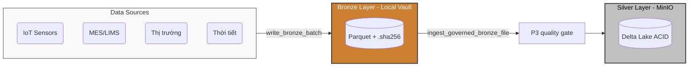

# Lakehouse workflow đến Silver

Luồng mới chạy bằng [Airflow](../../docs/lakehouse_airflow.md): mock S1–S5 →
Bronze immutable → P3 gate → sáu Delta Silver tables → pinned version manifest.
USDA chỉ Bronze; Gold là backlog. CLI dùng cùng callable với DAG, có thể chạy
độc lập để tách lỗi xử lý dữ liệu và lỗi điều phối.

Bắt đầu tại [demo](../../docs/storage_demo.md), [mock](../../docs/mock_server.md),
[API](API_REFERENCE.md), [vận hành](../../docs/storage_operations.md),
[versioning](../../docs/data_versioning.md),
[giải thích toàn bộ code task](../../docs/lakehouse_code_walkthrough.md).

## Hướng dẫn nền và lịch sử trước Airflow

Phần scheduler cũ dưới đây dành cho image trước cutover; runtime hiện hành dùng
maintenance_cli và Airflow, không chạy đồng thời hai bộ lịch cùng target.

# 🥛 Lakehouse Storage Module

> **Smart Dairy Factory Lakehouse Core Engine**  
> Quản lý toàn bộ vòng đời lưu trữ dữ liệu nhà máy sữa UHT theo kiến trúc Medallion (Bronze ➔ Silver) trên nền **MinIO (S3)** và **Delta Lake**.

---

## 🏗️ Kiến trúc luồng dữ liệu (Data Flow)



---

## ⚡ Quick Start (Copy & Paste)

Luồng chính cho dữ liệu dùng với Gold là generator → Bronze → P3 → Silver.
Cài dependencies P3 theo `requirements.txt` và bộ pin dịch vụ nếu cần. Chọn roots
riêng; local Delta trong môi trường này nên dùng đường dẫn tuyệt đối không có dấu cách.

```bash
PYTHONPATH=src .venv/bin/python -m lakehouse_storage.mock_sensor_stream \
  --batches 1 --samples 20 --seed 42 \
  --bronze-root /tmp/storage_generator/bronze \
  --silver-root /tmp/storage_generator/silver \
  --reports-root /tmp/storage_generator/reports

PYTHONPATH=src .venv/bin/python -m lakehouse_storage.generate_mes_data \
  --days 1 --date 2026-01-15 --seed 5425 --defect-rate 0 --write-delta \
  --bronze-root /tmp/storage_production/bronze \
  --silver-root /tmp/storage_production/silver \
  --reports-root /tmp/storage_production/reports \
  --output-dir /tmp/storage_production/synthetic
```

`--silver-root` hoặc `STORAGE_GENERATOR_SILVER_ROOT` bắt buộc khi CLI ghi Delta.
`STORAGE_GENERATOR_BRONZE_ROOT` và `STORAGE_GENERATOR_REPORTS_ROOT` cung cấp default
cho hai roots còn lại. CLI in toàn bộ kết quả P3; FAIL/infrastructure error trả
exit code 1. Gate giữ threshold 0.005; dữ liệu mock có thể bị từ chối.

### Bộ sinh MES/cảm biến theo cơ chế mô phỏng

CLI MES mặc định sinh **hai dây chuyền** trong config: 8 lô và 57.600 mẫu
cảm biến mỗi ngày. Truyền `--line-id LINE_UHT_1` để giữ khối lượng một line
như trước; có thể truyền danh sách line phân cách bằng dấu phẩy.

| Cờ ghi | Hành vi |
|---|---|
| Không có cờ | Parquet tổng hợp theo tên tháng trong `--output-dir` |
| `--write-bronze` | Append Parquet + checksum vào `--bronze-root`, chưa chạy P3 |
| `--write-delta` | Bronze → P3 → Silver tại `--silver-root`; bị từ chối trả mã 1 |

Hai cờ ghi loại trừ nhau. Cả ba chế độ lưu `batch_farm_map.json` trong
`--output-dir`, gộp mapping cũ theo batch ID và chặn conflict/JSON hỏng.
Mapping được thay qua file tạm; chỉ chạy một writer cho cùng output directory.
Sau publish Bronze, mapping được lưu trước P3; khi P3 reject, Bronze/mapping
và các commit Silver trước đó vẫn được giữ. Đây không phải transaction hai bảng.

Các hệ số defect, yield, flow và power được ghi tại
[ground_truth.md](../../docs/ground_truth.md). Seed ngày đầu mặc định 5425;
ngày sau tăng 1, seed 0 hợp lệ. Khi sinh tiếp bằng lệnh riêng, phải tăng seed
đúng offset ngày. Bảo đảm tách seed được kiểm tra cho bộ 90 ngày và hai line;
không có bảo đảm seed duy nhất cho mọi khoảng ngày hoặc line tùy ý. Giá trị
theo seed và phân phối MES đổi so với generator cũ, trong khi schema và lời gọi
cũ được giữ. `_generated_at` tiếp tục dùng thời gian thực.

Ví dụ Linux/WSL để sinh và kiểm tra **file Bronze thực** trong root riêng:

```bash
mes_demo_root=$(mktemp -d /tmp/mes-production-XXXXXX)
PYTHONPATH=src .venv/bin/python -m lakehouse_storage.generate_mes_data \
  --date 2025-01-01 --days 1 --seed 5425 --write-bronze \
  --bronze-root "$mes_demo_root/bronze" --output-dir "$mes_demo_root/synthetic"
PYTHONPATH=src .venv/bin/python scripts/verify_mes_dataset.py \
  --bronze-root "$mes_demo_root/bronze" \
  --mapping-file "$mes_demo_root/synthetic/batch_farm_map.json" \
  --start-date 2025-01-01 --days 1 --seed 5425 --output "$mes_demo_root/acceptance.json"
```

Verifier đọc từng file và giữ thống kê theo lô để kiểm checksum, schema,
counts, batch IDs, chuỗi timestamp 1 Hz và farm mapping; PASS là nghiệm thu
Bronze mô phỏng, chưa phải P3/Gold. `--seed` của verifier là thông tin khai báo,
không được suy ngược từ Parquet. File report phải nằm ngoài Bronze và khác
file mapping. Đổi `--days 90` ở cả hai lệnh để nghiệm thu bộ 720 lô.

Bronze chỉ append; chạy lại cùng window không phải replay/dedup. Dùng namespace
mới khi sinh lại cơ chế; không tự đổi nguồn Silver/Gold của nhóm. Gold hiện đọc
mapping mặc định `data/synthetic/batch_farm_map.json`; custom output cần được
truyền qua `load_batch_farm_map(path=...)` trong quy trình dựng marts.
Raw export vẫn dùng tên tháng bắt đầu và có thể bị ghi đè khi chạy lại; bộ dài
nên dùng Bronze streaming. Bronze writer hiện dùng filesystem POSIX, nên
native Windows chưa được nghiệm thu. Mock server/Airflow vẫn dùng generator
cảm biến riêng; chúng chưa có toàn bộ quan hệ cơ chế của daily CLI.

Entry point tương ứng cho một file Bronze đã có:

```python
from lakehouse_storage import ingest_governed_bronze_file, trace_batch
from olap_engineering.build_marts import scan_silver

result = ingest_governed_bronze_file(
    bronze_path, "sensor_telemetry",
    bronze_root="/tmp/storage_generator/bronze",
    silver_root="/tmp/storage_generator/silver",
    reports_root="/tmp/storage_generator/reports",
)
if result["status"] not in {"PASS", "PASS_WITH_REJECTIONS", "SKIPPED_DUPLICATE"}:
    raise RuntimeError(result)
accepted = scan_silver("sensor_telemetry", "/tmp/storage_generator/silver").collect()
```

Replay cùng file dùng gate chống trùng hiện có của P3. Đây là đường ghi tuần tự;
không đảm bảo exactly-once giữa nhiều process. Bảng legacy thiếu governance bị
báo lỗi, không tự migrate hoặc tự gắn PASS. Adapter demo vẫn giới hạn namespace.

Các helper `write_sensor_batch`, `write_mes_batch`, `_write_sensor_to_delta`,
`ingest_bronze_file` và `append_to_delta` là API storage low-level tương thích:
chúng có thể ghi lineage nhưng không chạy quality gate. Dữ liệu từ những helper
này chưa đảm bảo điều kiện Gold. Demo storage thuần chỉ nên dùng target riêng.

---

## 🛠️ Tùy chọn cấu hình môi trường

Tất cả cấu hình được quản lý qua biến môi trường (hoặc file `.env` ở thư mục gốc).

> [!IMPORTANT]  
> Yêu cầu phải khởi động MinIO container trước khi thực hiện thao tác với tầng Silver:  
> `docker compose -f infra/docker-compose.minio.yml up -d`

```bash
# S3 Configuration
MINIO_ENDPOINT=localhost:9000
MINIO_ACCESS_KEY=dairy
MINIO_SECRET_KEY=hustit5425
MINIO_BUCKET=smart-dairy-lakehouse

# Local Bronze Directory
BRONZE_PATH=data/01_bronze_vault
```

---

## 📂 Danh mục bảng dữ liệu (Tables Registry)

| ID | Bảng (`table_name`) | Phân vùng vật lý (`partition_by`) | Nguồn / Ý nghĩa |
| :-- | :--- | :--- | :--- |
| **S1** | `sensor_telemetry` | `line_id`, `ingestion_date` | IoT Telemetry cảm biến nhiệt, áp suất |
| **S2** | `mes_lims` | `line_id`, `ingestion_date` | Nhật ký mẻ sản xuất & kiểm nghiệm vi sinh |
| **S3** | `market_prices` | `ingestion_date` | Giá nguyên liệu thế giới (GDT, CME, USDA) |
| **S3b**| `market_indices` | `ingestion_date` | Chỉ số giá sữa FAO (Dữ liệu vĩ mô) |
| **S4** | `weather` | `farm_id`, `ingestion_date` | Thời tiết trang trại & chỉ số THI stress |
| **S5** | `food_recalls` | `ingestion_date` | Cảnh báo thu hồi an toàn thực phẩm FDA/VFA |
| **Meta**| `bronze_metadata` | `fetched_at` | Metadata quy trình cào dữ liệu tự động |

---

## 🧩 Tổng quan Modules

- **`schemas`**: Chứa PyArrow Schemas trung tâm (Source of Truth).
- **`bronze_writer`**: Xử lý ghi dữ liệu raw xuống ổ cứng cục bộ an toàn, chống ghi đè.
- **`silver_manager`**: Quản lý thao tác đọc/ghi ACID với Delta Lake MinIO.
- **`time_travel`**: Cung cấp hàm tra cứu quá khứ & hỗ trợ kiểm toán chất lượng.
- **`maintenance`**: Công cụ dọn rác, chống phân mảnh (`compact`, `z-order`, `vacuum`).

> [!TIP]  
> Mọi hàm public, cấu trúc tham số, và các ngoại lệ (Exception) đều được tài liệu hóa chi tiết tại:  
> 👉 **[API_REFERENCE.md](API_REFERENCE.md)**

## Isolated storage services and benchmark (2026-11-17)

The optional demo adds persisted S1/S2 mock HTTP, one checkpointed worker through
P3, a UTC maintenance scheduler, and measured layout benchmarks with four charts.
Start with [the walkthrough](../../docs/storage_demo.md),
[operations](../../docs/storage_operations.md),
[benchmark commands](../../docs/storage_benchmark.md).
Benchmark output is generated locally for each run; measured results depend on
the environment and are not included in the repository.

Install service dependencies with the separate pinned constraints; core imports,
writer signatures, Silver schemas/partitions and shared URIs remain compatible.
The worker is sequential and local. It reuses known Bronze files; uncertainty in
PUBLISHING stops at NEEDS_REVIEW. PROCESSING retries use P3's existing duplicate
gate and do not infer pre-crash row counts. There is no distributed exactly-once
claim. Stop ingestion before enabling maintenance. Vacuum is preview-only with
>=168-hour retention enforcement. No metadata contract was changed.
