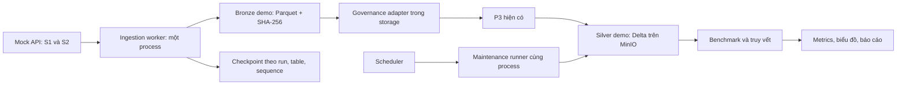
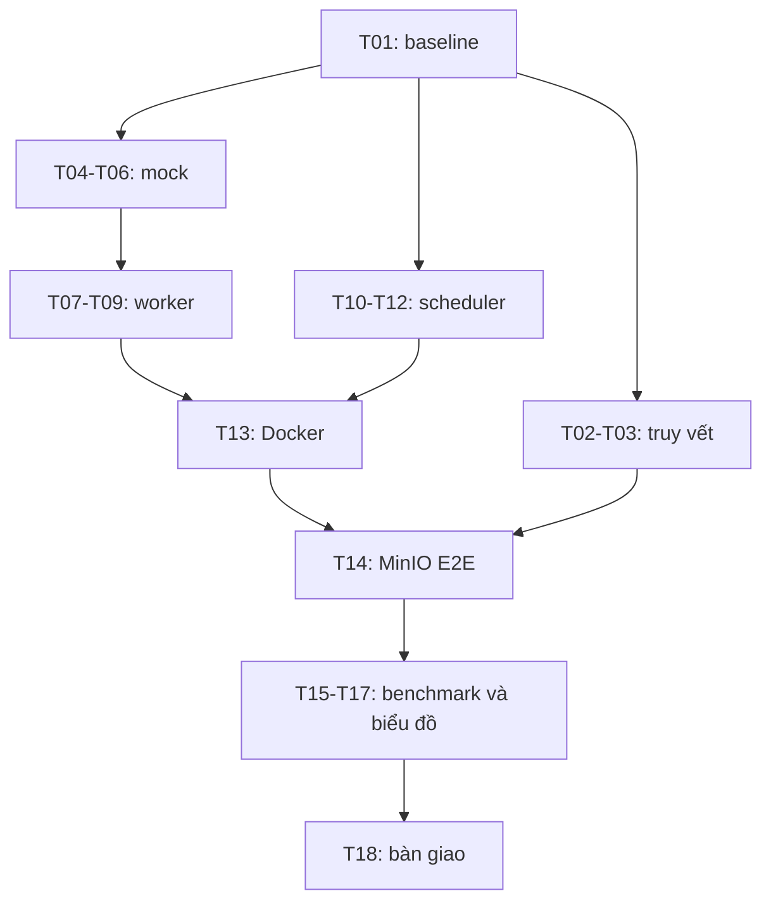

# Kế hoạch Lakehouse Storage: Mock, Worker, Scheduler & Benchmark

Cập nhật: 2026-11-17. Branch: `feature/lakehouse-reliability-automation`.
Trạng thái: đã thống nhất phạm vi với người dùng; tài liệu này là kế hoạch, chưa triển khai.
Task list và tiến độ: [todo.md](todo.md).

## 1. Phạm vi đã chốt

Xây dựng một demo xuyên suốt phục vụ môn Quản trị và Trực quan hóa dữ liệu: **mock server + ingestion worker tối thiểu + maintenance scheduler + benchmark/biểu đồ + sửa hai lỗi truy vết đã biết**. Docker Compose và kiểm thử tích hợp là phần hỗ trợ của gói này.

Kế hoạch này thay thế trực tiếp bản 27 task trước theo yêu cầu thu hẹp phạm vi. Các task cũ chưa triển khai, chưa có bằng chứng hoàn thành; đánh số mới T01–T18. Không coi task bị bỏ là đã hoàn thành. `docs/plan.md` và `docs/overlap_analysis.md` cũ không dùng làm nguồn trạng thái cho kế hoạch này.

| Hạng mục | Đầu ra tối thiểu | Tasks |
|---|---|---|
| Baseline và sửa truy vết | API tương thích; chọn đúng version; xác minh mọi file nguồn của batch | T01–T03 |
| Mock server | API S1/S2 có payload lưu bền vững, replay và kịch bản lỗi | T04–T06 |
| Ingestion worker | HTTP → Bronze → P3 hiện có → Silver; checkpoint và retry hữu hạn | T07–T09 |
| Maintenance scheduler | Policy → runner → compaction/Z-order/vacuum preview; lịch sử chạy | T10–T12 |
| Docker và tích hợp | Mock, worker, scheduler và MinIO; namespaces/volumes demo riêng | T13–T14 |
| Benchmark, biểu đồ, bàn giao | Harness, số liệu thực, ít nhất 4 biểu đồ và demo tái lập | T15–T18 |

### Không thuộc lần triển khai này

- Viết lại Bronze publisher, thêm manifest bắt buộc, bootstrap dữ liệu legacy.
- Ingestion ledger đầy đủ, commit metadata mới, distributed lock, exactly-once đa worker/đa host hoặc phục hồi mọi crash window.
- Gia cố/chuyển chính sách ghi của `append_to_delta()`, `ingest_bronze_file()` hay thay đổi schema Silver.
- Viết lại P3, quality gate, quarantine, THI/Hampel, pipeline OLAP/SPC hoặc dashboard nhóm.
- Mở rộng diff phiên bản theo khóa ghép, remediation tickets hoặc hệ thống retention/audit toàn cục.
- Scheduler tự động xóa file; production rollout lên bảng dùng chung không nằm trong demo mặc định.

## 2. Ràng buộc bảo vệ downstream

1. Mã chức năng mới nằm trong `src/lakehouse_storage/`. File hỗ trợ nằm trong `tests/`, `infra/`, `docs/` và `tasks/`.
2. Không chỉnh mã hoặc test hiện có của `data_governance`, crawling, `olap_engineering`, `manufacturing_spc` và các module khác. Chạy tests downstream nguyên trạng để tìm regression.
3. Giữ schema, dtype nghiệp vụ, partition, alias, tên bảng, URI mặc định và semantics `ingestion_date` hiện có. Chỉ cấu hình root riêng cho demo/benchmark qua API hiện có.
4. Giữ chữ ký và kiểu trả về của API cũ. Sửa `time_travel.py` có thể bổ sung trường lineage nhưng giữ mọi khóa cũ. Không thay hành vi ghi của `silver_manager.py` hoặc `bronze_writer.py`.
5. P3 là nơi transform, kiểm định, loại dòng lỗi và ghi governance columns. Worker gọi P3 qua adapter trong storage; không tự gán PASS và không nạp Silver trực tiếp để bỏ qua gate.
6. FastAPI, Uvicorn, APScheduler và thư viện vẽ chỉ import tại module/entry point mới. `import lakehouse_storage` tiếp tục dùng môi trường core cũ, không bắt buộc cài dependencies dịch vụ.
7. Mặc định mọi hoạt động sinh/nạp dữ liệu, maintenance và benchmark dùng demo namespace được allowlist. Mã mới từ chối target shared ngoài allowlist, không thay URI/credential của cả nhóm.
8. Ghi rõ ảnh hưởng hành vi của hai sửa lỗi truy vết: chọn version đúng hơn; integrity tổng có thể chuyển từ true sang false khi nguồn thứ hai bị hỏng. Đây là sửa tính đúng, không đổi dữ liệu Silver.

### Ma trận tác động

| Module | Điểm tiếp xúc | Biện pháp |
|---|---|---|
| P2 crawling | Generator/storage APIs, Bronze format | Không đổi writer, checksum convention hoặc schema |
| P3 governance | Adapter gọi `process_bronze_file()` | Lazy import, truyền roots riêng và dùng response hiện có; không monkeypatch |
| P4 OLAP | Silver schema/URI và logical rows | Demo root riêng, schema cũ, check counts trước/sau maintenance |
| P5/P6/P7 | Gold, phân tích và báo cáo | Không thay nguồn dữ liệu nhóm hoặc code downstream |
| Caller time-travel | Version lookup, trace result | Regression tests cho signature/keys và corrected semantics |

## 3. Hiện trạng làm cơ sở

- Đã có generators sensor/MES, Bronze writer + checksum, Silver writer/reader, time travel và maintenance.
- Hai lỗi đã tái hiện ở lượt khảo sát trước: `get_version_at_date()` trả version quá cũ; `trace_batch()` chỉ kiểm tra file đầu tiên khi batch có nhiều nguồn.
- P3 hiện có `process_bronze_file()`, quality gate, `already_ingested()` và writer có checksum/contract version. Tận dụng cho một worker tuần tự; không nâng bảo đảm thành concurrency-safe.
- `compact_table()` hiện nhận `target_file_size_mb` nhưng chưa truyền giá trị này xuống optimize. T10 kiểm chứng và sửa cục bộ nếu policy sử dụng tham số; giữ chữ ký cũ.
- `vacuum_table()` mặc định dry-run, nhưng không enforce retention floor mặc định. Runner mới luôn gọi preview với retention >= 168 giờ và enforce bật; không sửa policy của caller cũ.
- Nhóm storage đã có kết quả 104 tests pass trong lượt khảo sát trước; T01 phải chạy lại baseline. Không coi đó là xác nhận tất cả module hiện tại.
- Môi trường khảo sát có PyArrow khác giới hạn trong requirements. T01 chốt môi trường dịch vụ riêng có thể dựng lại; không nâng dependency chung để chữa bằng suy đoán.

## 4. Kiến trúc và cách chạy

### 4.1 Mock server

- FastAPI + Uvicorn; chỉ giả lập S1 sensor và S2 MES, tái sử dụng generator hiện có. Không tự ghi Bronze hoặc Silver.
- API dự kiến: `GET /health`, `POST /runs`, `GET /runs/{id}`, `GET /runs/{id}/batches/{sequence}`. Batch envelope có `run_id`, `sequence`, `table_name`, payload digest và dữ liệu raw.
- Tạo run cố định seed, start time, metadata thời gian và batch/line IDs. Sensor phải nằm trong production window của MES. Thời gian mẫu 1Hz độc lập với tốc độ phát batch.
- Lưu payload bytes theo run/sequence trên volume; replay sau restart trả đúng bytes. Không chỉ gọi generator lại với cùng seed vì `_generated_at` hiện dùng thời gian thực.
- Giới hạn samples/batch, số batch và kích thước response; request điều khiển sai trả 422, run/sequence không tồn tại trả 404. Core imports không phụ thuộc API.
- Scenarios tối thiểu: normal, invalid-value/invalid-time, thiếu trường bắt buộc, transient HTTP 500, response delay và replay.
- Phân biệt lỗi cấu trúc bị chặn trước/trong Bronze writer với lỗi giá trị đi tới P3. Không tắt validation mặc định của writer để cố đẩy mọi loại payload xuống P3.
- HTTP request replay theo sequence và run identity; chưa cần broker, WebSocket hay API tạo job phân tán.

### 4.2 Worker tối thiểu

- Một process worker cho namespace demo, chạy `--once`, số batch giới hạn hoặc liên tục. Dùng single-instance guard ở entry point mới trên volume local; không thay writer P3 để hỗ trợ nhiều process.
- Gọi mock API → kiểm tra envelope/digest → biểu diễn DataFrame theo raw schema → `write_bronze_batch()` → xác minh checksum → lưu checkpoint → adapter gọi P3.
- JSON có thể làm mất phân biệt numeric dtype. Client dùng Bronze schema để khôi phục kiểu raw ở dữ liệu hợp lệ, giữ extra fields; không tự sửa giá trị sai, chuẩn hóa nghiệp vụ hay gán quality status.
- Adapter lazy import `data_governance.run_governance.process_bronze_file()`; truyền `bronze_root`, `silver_root`, reports/quarantine/figures roots. Chỉ chạy kiểm định/tính toán P3 hiện có, không sao chép rule.
- Checkpoint nhỏ trên filesystem local, ghi temp + atomic replace, mỗi identity `(run_id, table_name, sequence)` có payload digest, Bronze path/hash, trạng thái, attempts, P3 status và rows_written đã báo. Không cần SQLite ledger ở bản này.
- Trạng thái dự kiến: `FETCHING`, `PUBLISHING`, `BRONZE_READY`, `PROCESSING`, `DONE`, `REJECTED`, `FAILED`, `NEEDS_REVIEW`. Đây là bookkeeping của worker, không phải transaction coordinator cho Delta.
- Chỉ đánh dấu DONE sau kết quả P3 hợp lệ; REJECTED lưu nguyên lỗi và có policy stop/skip rõ ràng. Default dừng tại batch lỗi cần can thiệp; demo có thể chọn tiếp tục batch sau có ghi nhận.
- Khi đã có Bronze path, retry/replay phải dùng file đó và kiểm tra checksum. Không serialize lại Parquet vì bytes/hash có thể khác.
- Replay cùng identity có thể skip từ checkpoint; lệnh replay demo cho phép gọi lại P3 trên cùng file để chứng minh duplicate gate không thêm dòng.
- Khi restart ở PROCESSING, có thể đưa lại cùng file cho P3 trong điều kiện một writer tuần tự. Nếu kết quả commit cũ không xác định, ghi status/metrics unknown thay vì suy ra số dòng đã commit trước crash. Không triển khai recovery transaction đầy đủ.
- Crash sau khi ghi Bronze nhưng trước khi lưu đường dẫn checkpoint: đánh dấu NEEDS_REVIEW ở PUBLISHING, liệt kê artifact liên quan để người vận hành kiểm tra; không tự ghi lại rồi tiếp tục hoặc xóa orphan. Phạm vi này chủ động không bảo đảm tự hồi phục mọi crash window.
- HTTP retry chỉ cho timeout/network/429/5xx được phân loại, max attempts + backoff hữu hạn. Không retry vô hạn schema/quality failure. P3 exception có thể được chuyển thành result lỗi: adapter phải đọc status, không chỉ bắt exception.
- SIGTERM hoàn tất batch hiện tại trong thời gian cho phép hoặc giữ checkpoint để resume. Không bỏ qua sequence dở. State hỏng/digest không khớp dừng có lỗi rõ ràng.

### 4.3 Scheduler và maintenance runner

- APScheduler 3.x trong một process, gọi trực tiếp `MaintenanceRunner`. Không có maintenance worker container hoặc queue riêng.
- Runner callable độc lập để CLI/test gọi one-shot. Policy theo bảng gồm file-count threshold, small-file ratio, target size, cooldown, lịch UTC và tùy chọn Z-order.
- Compaction là chức năng chính. Z-order mặc định tắt, chỉ bật cột không phải partition và có query benchmark phù hợp. Vacuum chỉ preview: `dry_run=True`, retention >= 168 giờ, `enforce_retention_duration=True`.
- Chỉ một maintenance job hoạt động mỗi lúc; scheduler single-instance guard, job id ổn định, coalesce, misfire grace và không catch-up vô hạn sau restart.
- Chống chồng maintenance không đồng nghĩa khóa được mọi writer. Phương án demo chính là hai pha: worker ingest xong và thoát/đã xác nhận dừng → bật maintenance profile. Continuous worker phải được dừng sạch trước khi bảo trì.
- Scheduler mặc định disabled cho mutation cho đến khi cấu hình maintenance window/demo phase; ghi rõ precondition ingestion đã dừng. Không dùng việc quan sát Delta version đứng yên trong vài giây như bằng chứng không có writer.
- Không triển khai khóa chung vào P3/append_to_delta; không tuyên bố an toàn với writer ngoài demo. Khả năng thử nghiệm vừa ingest vừa compact để sau.
- Record mỗi lần: run_id, table, action, lý do run/skip, start/end, duration, version/file count/active bytes trước và sau, error. Log JSONL append theo một process, đọc lại để khôi phục cooldown; record dở được coi là unknown/failed, không tự phát lại destructive action.
- Active-file bytes giảm không đồng nghĩa disk/object-store bytes đã được giải phóng: Delta giữ file cũ phục vụ lịch sử. Báo active bytes và retained/physical bytes riêng nếu đo được; vacuum preview không báo đã giải phóng dung lượng.
- Sửa cục bộ tham số target size trong maintenance nếu cần, có test call adapter + test Delta thật; không refactor toàn bộ maintenance API.

### 4.4 Sửa hai lỗi truy vết

- `get_version_at_date()`: chọn commit mới nhất có timestamp <= thời điểm hỏi; trả None trước commit đầu tiên; bảo toàn ý nghĩa timezone offset, không thay offset bằng UTC một cách cơ học.
- `trace_batch()`: thêm danh sách `lineage_sources` gồm các cặp path/hash duy nhất và trạng thái từng nguồn. Giữ `lineage` cũ làm nguồn đại diện tương thích, ghi rõ người dùng muốn đầy đủ phải đọc danh sách mới.
- `integrity_verified` tổng chỉ true khi mọi nguồn hợp lệ. File thiếu, hash null hoặc checksum sai phải có lý do rõ; hash mỗi source một lần. Không làm toàn bộ trace mất kết quả chỉ vì một nguồn không đọc được.
- Một file bị ghi nhận với hai expected hash khác nhau là conflict, không được hợp nhất thành trạng thái hợp lệ. Batch một file giữ output cũ tương thích, bổ sung field mới.
- Không mở rộng composite diff, thay schema hoặc sửa mọi API lịch sử trong gói này.

### 4.5 Docker và namespace

- Dockerfile riêng `infra/Dockerfile.storage`; dependencies dịch vụ và constraints riêng, core không import chúng. Adapter cần dependencies hiện có của P3 trong image worker.
- Một stack demo riêng có mock, worker, scheduler và MinIO; pin các phiên bản đã kiểm thử. Có thể tái dùng cấu hình MinIO nhưng không khởi động hai container tranh cổng host.
- Worker và scheduler là hai profile/pha vận hành tách nhau. MinIO healthcheck/readiness và client runtime retry đều cần; `depends_on` không thay thế retry khi service gián đoạn.
- Variables mới namespace `STORAGE_DEMO_*` cho roots, `MOCK_*` cho API và `MAINTENANCE_*` cho policy; không sửa mặc định MINIO/Silver của downstream. Mọi config mới lấy qua env/module cấu hình dịch vụ.
- Bronze/worker state/mock payloads/reports có volume riêng. Mount Bronze cùng absolute path giữa các công cụ cần trace; worker/P3 trong cùng container giúp giữ đường dẫn lineage.
- Bind-mount reports ra host để mở biểu đồ. Mock không cần credentials MinIO. URI demo/benchmark bắt buộc nằm dưới root đã allowlist.

## 5. Benchmark và biểu đồ

### Câu hỏi đo lường

1. Batch size ảnh hưởng số file và tốc độ nạp thế nào?
2. Compaction giảm file count và thay đổi latency truy vấn bao nhiêu?
3. Lọc theo partition/cột cần đọc đem lại tác động gì?
4. Z-order có giúp workload lọc batch/timestamp cụ thể không?

### Thiết kế thí nghiệm

- Dữ liệu sensor cố định seed, scale, timestamps và partition. Small smoke trước, sau đó 100k/1M rows tùy tài nguyên; ghi rõ scale thực chạy, không bịa kết quả chưa đo.
- Batch size là biến thí nghiệm, ví dụ 1k/10k/50k rows. Tách ingest end-to-end (bao gồm HTTP/P3/reporting) khỏi thời gian storage nếu instrumentation đo được; không gọi toàn bộ thời gian P3 là thời gian ghi Delta.
- Baseline và optimized dùng logical dataset giống nhau. Nếu P3 loại dòng, so sánh trên tập accepted giống nhau và ghi input/accepted/rejected counts; kiểm tra query results trước khi so latency.
- Ghi version baseline, chạy compaction qua runner rồi version optimized; không vacuum trong benchmark. Dùng bản sao bảng riêng để so Z-order độc lập khi cần.
- Query mẫu: line/date aggregate, batch lookup, hourly aggregate. Các phép so query phải cùng semantics; nếu so các queries trả khác số dòng thì ghi là workload khác, không báo speedup trực tiếp.
- Ít nhất 1 warm-up + 5 lần đo mỗi cấu hình, báo median và dispersion. Ghi thứ tự chạy/cache policy, CPU/RAM/disk, container limits, package versions và query text. Không gọi cold-cache nếu không kiểm soát được cache.
- Đo file count, size distribution, active bytes, retained physical bytes nếu có, query latency, compaction duration, rows/s và worker outcome counts. Không đặt speedup làm điều kiện pass; kết quả không nhanh hơn vẫn hợp lệ nếu giải thích được.
- Phân biệt CSV/Parquet/Delta chỉ khi bổ sung thí nghiệm định dạng có cùng encoding/compression/workload; không suy ra Delta mặc nhiên nén tốt hơn Parquet. Thí nghiệm này tùy chọn, không chặn gói tối thiểu.

### Artifact tối thiểu

`reports/storage/<run_id>/` chứa config/environment, raw JSON/CSV metrics, operation log và summary. Biểu đồ PNG/SVG:

1. Số file trước/sau compaction.
2. Phân bố kích thước file trước/sau.
3. Query latency theo phương án, có dispersion và đơn vị.
4. Throughput end-to-end theo batch size, ghi rõ có bao gồm P3.

Báo cáo mô tả kết quả, giới hạn và trade-off; không dùng synthetic correlation để kết luận nhân quả nghiệp vụ. Benchmark P1 tập trung physical layout và maintenance, không viết lại benchmark engine của P4.

## 6. Các giai đoạn và phụ thuộc

| Giai đoạn | Tasks | Kết quả checkpoint |
|---|---|---|
| A. Baseline + truy vết | T01–T03 | Dependency dựng lại được, hai lỗi sửa đúng, API cũ tương thích |
| B. Mock server | T04–T06 | HTTP API có replay sau restart và lỗi xác định |
| C. Worker tối thiểu | T07–T09 | Một worker gọi P3, checkpoint/resume/replay hoạt động trong phạm vi đã nêu |
| D. Maintenance scheduler | T10–T12 | Policy, runner, lịch chạy và operation log; vacuum chỉ preview |
| E. Docker + benchmark harness | T13–T15 | Demo MinIO hai pha và harness có kiểm tra tính đúng |
| F. Thực nghiệm + bàn giao | T16–T18 | Số đo thật, biểu đồ, hướng dẫn và regression downstream |

Thứ tự mặc định theo số task. Có thể triển khai mock hoặc scheduler sau T01 theo dependency nếu sau này có phân công người khác; không yêu cầu nhiều agent. Không sửa cùng file cấu hình/API song song mà chưa phối hợp.

## 7. Kiểm thử và Definition of Done

- Mỗi task S/M, dự kiến tối đa 5 file chính, tối đa 3 tiêu chí nghiệm thu. Nếu vượt một phiên tập trung thì tách nhỏ trước khi triển khai.
- Regression tập trung sau từng task; checkpoint mỗi 3 task; full suite ở bàn giao. Các test downstream được chạy nguyên trạng, không sửa expected để che lỗi.
- Mock kiểm tra bytes replay qua restart; worker kiểm tra checkpoint và tái dùng Bronze; không viết test giả chứng minh exactly-once đa worker.
- MinIO tests dùng marker `minio` mới và namespace run-specific. Mọi phép dừng service/cleanup chỉ áp dụng stack demo và tài nguyên test tạo ra.
- Scheduler unit test dùng clock có thể điều khiển; có một smoke process thật cho lịch/shutdown. E2E xác nhận worker dừng trước maintenance và số dòng/logical query không đổi sau tối ưu.
- Trace tests phải tái hiện hai lỗi với nhiều versions và nhiều nguồn; baseline test cũ tiếp tục pass.
- Build image, healthcheck, pip check, import core không có optional packages và diff scope đều cần evidence. Môi trường thiếu dịch vụ phải ghi SKIP/BLOCKED cùng nguyên nhân, không báo pass.
- Artifact benchmark phải đủ để tái tạo biểu đồ. Không yêu cầu mọi test chạy lại sau thay đổi chỉ ở tài liệu.
- Không sửa source implementation trong giai đoạn lập kế hoạch này. Mỗi task implementation chỉ đánh dấu hoàn tất sau khi có evidence.
- Skill tham chiếu `.codex/references/definition-of-done.md`; file này không có ở lượt kiểm tra trước. DoD trong mục này áp dụng cho gói mới.

## 8. Rủi ro và giới hạn được chấp nhận

| Rủi ro | Cách xử lý trong gói nhỏ |
|---|---|
| JSON làm lệch raw dtype | Client mapping theo Bronze schema; tests raw fields/extra fields; không sửa nghiệp vụ |
| Cùng seed vẫn khác payload | Lưu payload bytes cố định, kiểm chứng digest sau restart |
| Retry tạo file Bronze mới | Checkpoint giữ file path/hash; tái dùng artifact; PUBLISHING dở cần review |
| P3 bắt exception và trả result lỗi | Adapter kiểm tra status và rows_written thay vì chỉ bắt exception |
| Crash sau commit | Retry known Bronze qua P3 trong một writer; trạng thái/metrics chưa rõ giữ unknown; không hứa recovery mọi tình huống |
| Hai worker/caller ghi cùng namespace | Chặn instance worker thứ hai; demo không có writer ngoài; multi-writer ngoài phạm vi |
| Maintenance chạy khi ingest chưa dừng | Demo hai pha, window rõ, scheduler mặc định không tự mutation; không dựa vào lock scheduler để tuyên bố khóa P3 |
| Vacuum gây mất lịch sử | Scheduler chỉ preview và retention >= 168h; không xóa thật trong demo |
| Số liệu dung lượng dễ gây hiểu nhầm | Phân biệt active files với toàn bộ retained files; preview không có bytes freed thực |
| Sửa trace làm caller thấy kết quả khác | Giữ API/keys; document corrected semantics; regression tests nguyên trạng |
| Dependency mới kéo hỏng downstream | Môi trường/image dịch vụ riêng; core import nhẹ, không nâng package chung ngoài phạm vi |
| Benchmark bị P3/reporting chi phối | Ghi đúng end-to-end latency, stage timing khi đo được, không gọi nhầm storage throughput |

## 9. Demo và bàn giao cuối

Kịch bản: khởi động mock/MinIO → tạo run S1/S2 → worker ingest qua P3 → replay cùng Bronze để thấy duplicate skip → chạy scenario lỗi có evidence → dừng worker sạch → bật scheduler, ghi compaction before/after → chạy query benchmark → truy vết batch nhiều file và version theo thời điểm → xuất báo cáo/biểu đồ. Vacuum chỉ trình diễn danh sách preview.

Chỉ số thành công: flow chạy lại được, counts giải thích được, giữ schema/lineage, không sửa downstream, maintenance không đổi logical rows, biểu đồ dùng số liệu thật. Scheduler và mock chỉ được coi hoàn tất khi góp phần vào luồng này, không chỉ vì container chạy được.

Phần để sau giữ trong backlog: atomic Bronze publisher, ledger/recovery đầy đủ, nhiều worker, khóa chung writer/maintenance, global strict Silver gate và destructive vacuum có retention audit. Không dùng chúng làm dependency ẩn của 18 task hiện tại.
